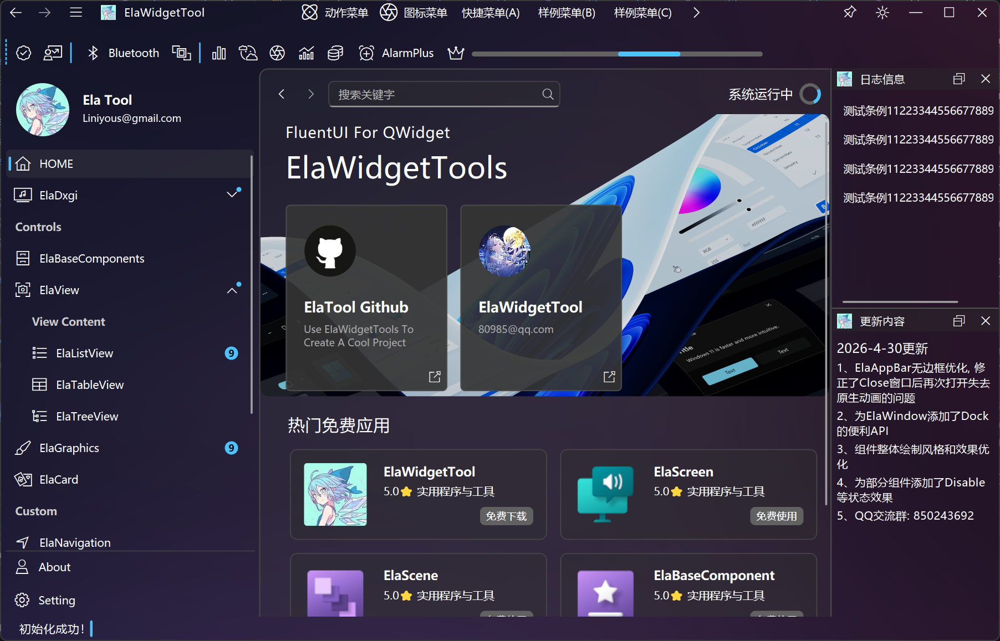

# ElaWidgetTools

## 简介

本项目是基于 [Liniyous/ElaWidgetTools](https://github.com/Liniyous/ElaWidgetTools) 的 Fork 版本，在原项目基础上进行了个人定制和修改。

原项目是基于 QT-Widget 开发的 FluentUI 风格的组件库，同时提供不限于组件的常用集成功能；上游 Main 分支支持 QT5.12 以上所有版本（Linux 为 QT5.15 以上），推荐版本为 QT5.15.2 和 QT6.6.2。本 Fork 在 Qt 6.8.3（MSVC 2022）下开发与验证。

## 项目官网

> 🌐 **[访问 ElaWidgetTools 官网](https://liniyous.com)**
>
> 查阅完整的 **API 文档** 与 **二次开发技能文档**，获取项目 **最新动态**。

## Fork 说明

**上游项目：** [Liniyous/ElaWidgetTools](https://github.com/Liniyous/ElaWidgetTools)（已同步至 V3.0 重构版本，属性、PIMPL 与单例宏统一为 `ELA_*`，属破坏性更新）

**Fork 目的：** 基于原项目进行个人定制和功能扩展

**主要修改：**
- 新增 ElaMessageBox 消息框（接口与 QMessageBox 相近：标准按钮、静态便捷函数、详细信息、复选框）
- 新增 ElaInputDialog 输入对话框（文本、多行文本、密码、整数、浮点数、列表选择）
- 新增 ElaTextEdit 多行文本编辑组件
- ElaPushButton 新增 Fluent UI v9 外观（Default/Primary/Outline/Subtle/Transparent）与形状（Rounded/Circular/Square），ElaToolButton 新增外观属性
- 主题新增 Fluent UI v9 全量色板
- ElaTableView 支持复选框列，ElaTabBar 选中项增加强调标记
- ElaAppBar 自定义区域不再占满标题栏，修复放置自定义控件后无法拖动窗口；新增 IsDefaultMinimized/IsDefaultMaximized，可接管最小化/最大化
- 适配 Qt 6.8.x：修复 Qt 6.8.2+ 下 ElaComboBox 深色主题文字重影，消除 Qt 6 弃用接口告警
- 修复若干空指针与越界问题（ElaAppBar、ElaMessageBar、ElaContentDialog）
- 行为差异：ElaText 默认字号 14px，ElaScrollPageArea 不固定高度，ElaContentDialog 默认按钮为中文
- 构建：提供一键编译安装脚本 `build_elawidgettools.ps1`（默认编译 Debug/Release 并安装到 `Install/`），以及 GitHub Actions Windows 构建

## 致谢

感谢 [Liniyous](https://github.com/Liniyous) 提供的优秀开源项目 ElaWidgetTools。

## 支持平台

| [Windows][win-link] | [Ubuntu/Kylin][ubuntu-link] |
|---------------------|-----------------------------|
| ![win-badge]        | ![ubuntu-badge]             |

[win-link]: https://github.com/Liniyous/ElaWidgetTools/actions?query=workflow%3AWindows "WindowsAction"

[win-badge]: https://img.shields.io/badge/Windows-Passing-61C263

[ubuntu-link]: https://github.com/Liniyous/ElaWidgetTools/actions?query=workflow%3AUbuntu "UbuntuAction"

[ubuntu-badge]: https://img.shields.io/badge/Ubuntu-Passing-61C263

## 主界面预览

  

  

 

## 支持的组件

标记说明：![Fork 新增][fork-new-badge] 本 Fork 新增的组件；![上游 补充收录][upstream-added-badge] 上游已有、原列表未收录的组件。

| 目录                     | 说明           | 备注                         |
|------------------------|--------------|----------------------------|
| ElaApplication         | 程序初始化        |                            |
| ElaAppBar              | 窗口顶部标题栏      | 支持拖动窗口，最小化、最大化、关闭窗口、调整窗口尺寸、自定义菜单；可接管最小化/最大化 |
| ElaAcrylicUrlCard      | 带图片的交互式亚克力卡片 | 支持URL跳转                    |
| ElaBreadcrumbBar       | 面包屑组件        | 自动处理点击事件                   |
| ElaCheckBox            | 勾选框          |                            |
| ElaComboBox            | 下拉框          |                            |
| ElaColorDialog         | 颜色选择器        |                            |
| ElaCalendar            | 日历视图         |                            |
| ElaCalendarPicker      | 日期选择器        |                            |
| ElaMultiSelectComboBox | 多选下拉框        |                            |
| ElaContentDialog       | 带遮罩的对话框      |                            |
| ElaDialog              | 无边框对话框       | 支持自定义标题栏按钮                |
| ElaMessageBox ![Fork 新增][fork-new-badge] | 消息框 | 接口与 QMessageBox 相近：标准按钮、静态便捷函数、详细信息、复选框 |
| ElaInputDialog ![Fork 新增][fork-new-badge] | 输入对话框 | 支持文本、多行文本、密码、整数、浮点数和列表选择 |
| ElaDockWidget          | 停靠窗口         |                            |
| ElaDrawerArea          | 抽屉窗口         |                            |
| ElaSpinBox             | 微调框          |                            |
| ElaDoubleSpinBox       | 微调框          | 浮点数                        |
| ElaDxgiManager         | DXGI采集器      | 支持自动选择采集设备 效率远高于原生采集       |
| ElaEventBus            | 事件总线         |                            |
| ElaFlowLayout          | 流式布局         | 支持动画                       |
| ElaIcon                | 图标           |                            |
| ElaIconButton          | 图标按钮         |                            |
| ElaImageCard           | 图片卡片         |                            |
| ElaInteractiveCard     | 带图片的交互式透明卡片  |                            |
| ElaKeyBinder           | 单按键绑定器       |                            |
| ElaLineEdit            | 输入框          |                            |
| ElaListView            | 列表视图         |                            |
| ElaLCDNumber           | LCD数字显示器     |                            |
| ElaLog                 | 消息日志         |                            |
| ElaMenu                | 菜单           |                            |
| ElaMenuBar             | 菜单栏          |                            |
| ElaRibbonBar ![上游 补充收录][upstream-added-badge] | 功能区（Ribbon） | 按页签与分组管理命令，可搭配 TabBar 或 Pivot |
| ElaMessageBar          | 弹出式信息栏       | 支持八方向，锚定位置                 |
| ElaMessageButton       | 弹出信息按钮       |                            |
| ElaPivot               | 轴转导航         |                            |
| ElaPlainTextEdit       | 文本编辑框        |                            |
| ElaTextEdit ![Fork 新增][fork-new-badge] | 多行文本编辑框 | 基于 QTextEdit，带焦点指示动画 |
| ElaPushButton          | 按钮           | 支持 Fluent UI v9 外观（Default/Primary/Outline/Subtle/Transparent）与形状（Rounded/Circular/Square） |
| ElaPopularCard         | 热门卡片         |                            |
| ElaProgressBar         | 进度条          |                            |
| ElaProgressRing ![上游 补充收录][upstream-added-badge] | 环形进度条 | 支持忙碌状态与数值显示 |
| ElaPromotionCard       | 促销卡片         |                            |
| ElaPromotionView       | 促销卡片视窗       |                            |
| ElaToggleButton        | 切换按钮         |                            |
| ElaSuggestBox          | 建议搜索框        |                            |
| ElaRadioButton         | 单选按钮         |                            |
| ElaActionCommander     | 命令式操作器       |                            |
| ElaToggleSwitch        | 开关按钮         |                            |
| ElaTabBar              | 选项卡          | 谷歌浏览器风格                    |
| ElaTabWidget           | 选项卡页面        | 谷歌浏览器风格                    |
| ElaTableView           | 表格视图         | 支持复选框列                     |
| ElaTreeView            | 树型视图         |                            |
| ElaToolButton          | 带下拉菜单的工具按钮   | 支持外观属性（ButtonAppearance）      |
| ElaToolBar             | 工具栏          |                            |
| ElaToolTip ![上游 补充收录][upstream-added-badge] | 工具提示 | 支持自定义控件与显示延时 |
| ElaTheme               | 主题管理器        | 含 Fluent UI v9 全量色板             |
| ElaReminderCard        | 带图片的提醒卡片     |                            |
| ElaRoller              | 无限滚筒选择器      |                            |
| ElaRollerPicker ![上游 补充收录][upstream-added-badge] | 滚筒选择按钮 | 点击弹出多列滚筒，支持循环滚动 |
| ElaScrollBar           | 滚动条          |                            |
| ElaScrollArea          | 滚动区域         | 可设置鼠标拖动                    |
| ElaScrollPage          | 滚动页面         | 自带堆栈页面和面包屑导航               |
| ElaScrollPageArea      | 滚动页面区域组件     |                            |
| ElaSlider              | 拖动条          |                            |
| ElaStatusBar           | 状态栏          |                            |
| ElaExponentialBlur     | 指数模糊         |                            |
| ElaText                | Text文本       |                            |
| ElaNavigationBar ![上游 补充收录][upstream-added-badge] | 导航栏 | ElaWindow 内置的导航栏组件，支持用户信息卡与页面新窗口打开 |
| ElaWindow              | 带导航栏的无边框窗口   |                            |
| ElaWidget              | 无边框模态窗口      |                            |

[fork-new-badge]: https://img.shields.io/badge/Fork-%E6%96%B0%E5%A2%9E-2EA44F

[upstream-added-badge]: https://img.shields.io/badge/%E4%B8%8A%E6%B8%B8-%E8%A1%A5%E5%85%85%E6%94%B6%E5%BD%95-1F6FEB

## 参考范例

以下是一些使用了ElaWidgetTools的优秀开源项目：

[KikoPlay-全功能弹幕播放器](https://github.com/KikoPlayProject/KikoPlay)

[EricTool-工业级多协议数据分析平台](https://www.erictool.online/ )

## 许可证

本项目遵循 MIT 许可证。原项目也采用 MIT 许可证。

## 联系方式

如有问题或建议，请通过 Issues 反馈。
